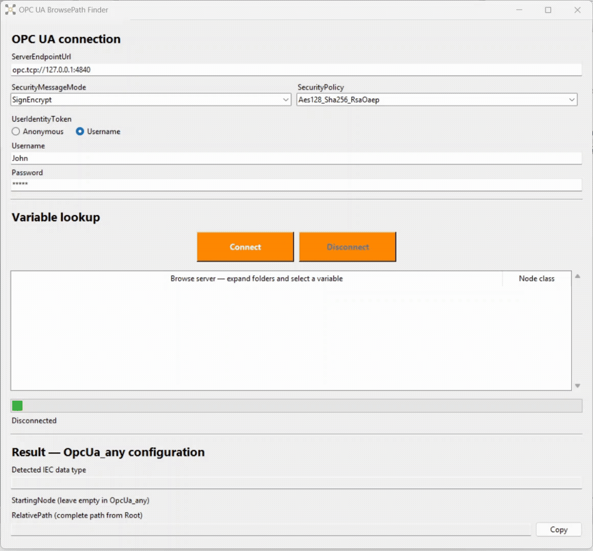

# OPC UA BrowsePath Finder

Windows utility for browsing OPC UA servers and retrieving variable paths for B&R Automation Studio's `OpcUa_any` configuration.

<p align="center">
  
</p>

<div align="center">
  <a href="https://github.com/br-automation-community/OpcUaAnyBrowsePathfinder/releases/latest">
    
  </a>

  <a href="https://github.com/br-automation-community/OpcUaAnyBrowsePathfinder/issues">
    
  </a>
</div>

## What it does

The tool connects to an OPC UA server and lets you browse its address space
to select a variable directly.

For the selected variable, it provides:

- The complete `RelativePath` from Root.
- The corresponding IEC data type for supported types.
- A copy button for transferring the path into Automation Studio "OpcUa_Any" configuration

The server browser loads child nodes when you expand a folder,
without scanning the entire server.

## Connection options

The application supports:

- Anonymous or Username/Password authentication.
- `None`, `Sign`, and `SignEncrypt` security modes.
- Security policies supported by the installed `asyncua` version and server.
- Automatic client application certificate generation.
- Server certificate approval using its SHA-256 fingerprint.
- Multiple approved server certificate fingerprints per endpoint and security configuration.

Available security policies include:

- `None`
- `Basic128Rsa15`
- `Basic256`
- `Basic256Sha256`
- `Aes128_Sha256_RsaOaep`

The selected security mode and policy must be offered by the server.

## Using the application

1. Enter the server endpoint, for example `opc.tcp://127.0.0.1:4840`.
2. Select the security mode and policy.
3. Select the authentication method and enter credentials if required.
4. Click **Connect**.
5. For an unfamiliar server certificate, verify its fingerprint before approving it.
6. Expand **Objects** and navigate to the required variable.
7. Select the variable to display its IEC data type and `RelativePath`.
8. Click **Copy** to copy the path.

Click **Disconnect** to close the connection and clear the browser.

## Using the result in Automation Studio

The generated `RelativePath` includes Root and Objects.
Leave `StartingNode` empty when using this path with `OpcUa_any`.

Paths retain the server's namespace indexes. Verify that the namespace
configuration in `OpcUa_any` matches the server before using the result.

## Supported data types

| OPC UA data type | IEC data type |
|------------------|---------------|
| Boolean | BOOL |
| Byte | USINT |
| SByte | SINT |
| UInt16 | UINT |
| Int16 | INT |
| UInt32 | UDINT |
| Int32 | DINT |
| Float | REAL |

Other types are displayed as unsupported.

## Certificates

The application stores its client certificate, private key, and approved
server fingerprints under:

```text
%LOCALAPPDATA%\OpcUaBrowsePathFinder\pki\
```

The OPC UA server may require you to approve the application's client
certificate before allowing a secure connection.

An unfamiliar server certificate requires approval. Once approved, its
fingerprint is saved for future connections. Previously approved
fingerprints remain trusted.

Server trust uses certificate fingerprint approval. Full certificate-chain,
hostname, expiration, and revocation validation are not implemented.

## Running the application

### Windows executable

[Download the latest release](https://github.com/br-automation-community/OpcUaAnyBrowsePathfinder/releases/latest)
→ Download the release archive → Extract it → Run the included executable.

No Python installation is required.

### Running from source

Developed and tested with Python 3.13.

From the project directory:

```powershell
python -m venv .venv
.\.venv\Scripts\python.exe -m pip install -r requirements-dev.txt
.\.venv\Scripts\python.exe src\gui_launcher.py
```

## Limitations

- Client application certificates are generated and managed automatically.
  Selecting an existing client certificate and private key is not supported.
- User authentication supports Anonymous and Username/Password only.
  Certificate-based user authentication is not supported.
- Server trust uses manually approved certificate fingerprints.
  Full certificate-chain, hostname, expiration, and revocation validation
  are not implemented.
- Only the IEC data type mappings listed above are supported.
- Generated paths use server namespace indexes, which must match the
  namespace configuration in `OpcUa_any`.
